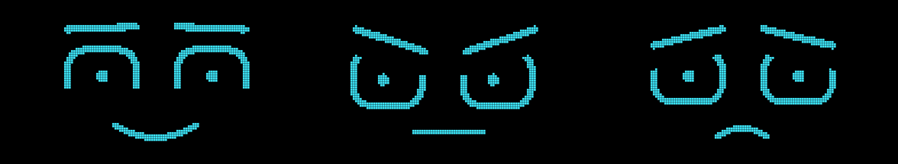

# Emma

Una asistente con cara. Vive en una pantalla de 128×64 en blanco y negro —
dos ojos, dos cejas y una boca — escucha por el micrófono del teléfono,
entiende lo que le decís y contesta en voz alta, cambiando de expresión
según lo que responde.

Es un asistente personal, no una herramienta de trabajo. Lo que sabe de vos
está en un solo archivo que vos controlás.

Busca en internet cuando hace falta —clima, noticias, precios— y sabe qué día y
qué hora es.

**Escuchar y hablar no cuestan nada.** El oído y la voz los pone el teléfono, con
lo que ya trae adentro: no gastan cuota de ninguna API. Solo pensar la respuesta
consume. Si el navegador no puede escuchar, siempre queda escribirle.



## Cómo se usa

Se abre en el navegador del celular. Mantenés apretado el micrófono, hablás,
soltás. También podés escribirle, que funciona en cualquier teléfono sin pedir
permisos.

Funciona igual en iPhone, Android, Mac y PC: el navegador graba el audio y se lo
manda al modelo, que entiende **y** contesta en la misma consulta. Por eso no
depende del reconocimiento de voz del navegador, que en iOS es poco confiable.

## Publicarla

```
1. Sacá una clave en console.anthropic.com
2. Entrá a vercel.com con tu cuenta de GitHub
3. Add New → Project → emma-cerebro- → Import
4. Environment Variables → ANTHROPIC_API_KEY = tu clave
5. Deploy
```

Si preferís el tier gratis de Google, la clave sale de aistudio.google.com/apikey,
va en `GEMINI_API_KEY`, y además hay que poner `CARA_PROVIDER` en `gemini`.

Listo. El link que te da es Emma.

No hace falta elegir modelo: Google va renombrando y jubilando los suyos, así que
Emma prueba los actuales en orden y se queda con el primero que su clave pueda usar.
Si ninguno anda, te dice cuáles sí tenés disponibles.

| Variable | Para qué |
|---|---|
| `ANTHROPIC_API_KEY` | La clave de Claude. Es la que usa por defecto |
| `GEMINI_API_KEY` | Opcional. Solo si querés el tier gratis, o el oído de respaldo |
| `CARA_PROVIDER` | `claude` (por defecto) o `gemini` |
| `CARA_MODEL` | Opcional. Para usar otro modelo. Con Gemini, si no la ponés, elige solo |

## Cuánto sale cada respuesta

Una charla típica son unos 1.600 tokens de entrada (la personalidad, lo que sabe
de vos y el hilo de la conversación) y 60 de salida. Con eso:

| Modelo | Por respuesta | Con 5 dólares |
|---|---|---|
| `claude-haiku-4-5` (por defecto) | ~0,2 centavos | ~2.500 respuestas |
| `claude-sonnet-5` | ~0,5 centavos | ~1.000 respuestas |
| `claude-opus-5` | ~1,2 centavos | ~400 respuestas |

Son estimaciones, no facturas: las búsquedas web se cobran aparte de los tokens,
y un hilo largo de conversación pesa más que uno corto.

Haiku alcanza de sobra para charlar de a una o dos frases. Si notás que se queda
corta pensando, cambiás `CARA_MODEL` a `claude-sonnet-5` y listo — el código se
adapta solo a lo que cada modelo acepta.

## Quién escucha y quién piensa

```
tu voz  →  el teléfono la pasa a texto     GRATIS, no toca ninguna API
              ↓
        Claude piensa y busca              tus créditos
              ↓
        el teléfono lo dice en voz alta    GRATIS
```

El reconocimiento de voz del navegador anda muy bien en Android y algo peor en
iPhone. Si falla y hay una clave de Gemini configurada, Emma manda la grabación
como respaldo. Si no hay ninguna de las dos, te lo dice y podés escribirle.

## Por qué no pide un JSON exacto

Google no permite exigir una respuesta con formato JSON estricto **y** buscar en
internet en la misma consulta: hay que elegir. Como la búsqueda vale más, Emma le
pide el formato con etiquetas en el prompt (`EMOCION:` y `RESPUESTA:`), que es el
que los modelos respetan mejor, y lo lee con un parser tolerante que acepta eso,
JSON pelado, JSON entre comillas triples, o prosa suelta. Si nada encaja, usa el
texto tal cual y pone cara neutral: nunca se rompe por el formato.

Con Claude sí se usa el esquema estricto, porque ahí no hay ese conflicto.

## Saber qué versión está viva

Si Emma se porta raro después de un cambio, abrí `/api/version` en tu link. Te dice
qué commit está publicado y si la clave está puesta — sin mostrar la clave.

Ojo con el botón **Redeploy** de Vercel: repite *el mismo commit*, no toma el código
nuevo. Para publicar lo último, empujá un commit (el despliegue sale solo) o promoví
a producción el despliegue que corresponde.

## Correrla en tu computadora

```bash
npm install
cp brain/.env.example brain/.env    # y pegás la clave adentro
node brain/server.js --provider gemini
```

Con `--provider ollama --model llama3.2` corre con un modelo de tu propia
máquina, sin clave y sin internet. Ese solo anda en la computadora.

## Qué hay adentro

| Carpeta | Qué es |
|---|---|
| `web/` | La cara y la página. `face.js` dibuja, `index.html` escucha y habla |
| `brain/cerebro.js` | La personalidad de Emma y los tres proveedores |
| `brain/proyectos.js` | **Lo que Emma sabe de vos.** Es lo único que hay que mantener |
| `brain/server.js` | Servidor local, para desarrollar |
| `api/chat.js` | El mismo cerebro como función serverless, para Vercel |
| `firmware/` | Los sketches de Arduino para la OLED física |

## Cómo mantenerla al día

Todo lo que Emma sabe está en **un solo archivo**: `brain/proyectos.js`.
Es texto común. Lo editás, y en el próximo despliegue ya está actualizada.

## La cara

Se dibuja de cero en cada cuadro, en un lienzo de 128×64 que después se pasa
por un umbral: cada pixel queda prendido o apagado, como en la pantalla real.
Por eso los bordes se ven escalonados.

Cada emoción es una fila de siete números en la constante `MOODS`:

| Parámetro | Qué controla |
|---|---|
| `browY` | Altura de las cejas |
| `browTilt` | Inclinación: positivo enoja, negativo entristece |
| `eyeH` | Alto del ojo |
| `lidTop` / `lidBot` | Cuánto tapa cada párpado |
| `mouthCurve` | Curva de la boca cerrada: positivo sonríe |
| `mouthW` | Ancho de la boca |
| `openBias` | Cuánto abre la boca antes de sumarle la voz |

Los mismos números están en el firmware de Arduino, así que la pantalla de
verdad se ve idéntica al simulador.

## Darle un cuerpo

Emma también puede vivir en una pantalla de verdad. Unos 13 dólares y sin soldar:

| Pieza | Qué mirar al comprarla | Aprox. |
|---|---|---|
| OLED 0.96" | Que sea **I2C** (4 pines) y **128×64**. No SPI, no 128×32 | 3 USD |
| ESP32 | Cualquier DevKit v1 | 5 USD |
| Micrófono analógico | MAX9814 o KY-038 (solo para `oled_face`) | 3 USD |
| Cables dupont | Macho-hembra | 2 USD |

| Del ESP32 | A la pantalla |
|---|---|
| `3V3` | `VDD` |
| `GND` | `GND` |
| `GPIO22` | `SCK` (a veces dice `SCL`) |
| `GPIO21` | `SDA` |

Hay dos sketches:

- **`firmware/oled_face/`** — Emma sola, sin computadora. Abre la boca según el
  volumen del micrófono y el botón BOOT le cambia la expresión.
- **`firmware/oled_face_ai/`** — Emma conectada. Obedece órdenes `MOOD:feliz` y
  `LEVEL:0.62` que le manda el servidor por el mismo cable USB con el que la
  programaste, así que la pantalla acompaña la conversación real.

Para la segunda, arrancá el servidor con el puerto:

```bash
stty -F /dev/ttyUSB0 115200 raw     # en macOS: stty -f /dev/cu.usbserial-... 115200 raw
node brain/server.js --provider gemini --serial /dev/ttyUSB0
```

El puente serie es para Linux y macOS. En Windows todo lo demás funciona igual,
pero para mover la pantalla física hace falta el paquete `serialport`.

Se cargan desde el IDE de Arduino con la placa *ESP32 Dev Module* y las librerías
**Adafruit SSD1306** y **Adafruit GFX**. Si la pantalla queda negra, casi siempre
es la dirección I2C: cambiá `0x3C` por `0x3D`.

## Lo que viene

- **Memoria propia.** Que se acuerde de las charlas anteriores, en Supabase.
- **Vivir en un aparato fijo.** Un Samsung S20 Exynos en el escritorio, siempre
  prendido, con ROM limpia.
- **Un modelo local para lo rápido.** Que conteste al instante lo simple y mande
  a la nube solo lo que necesita cabeza.
